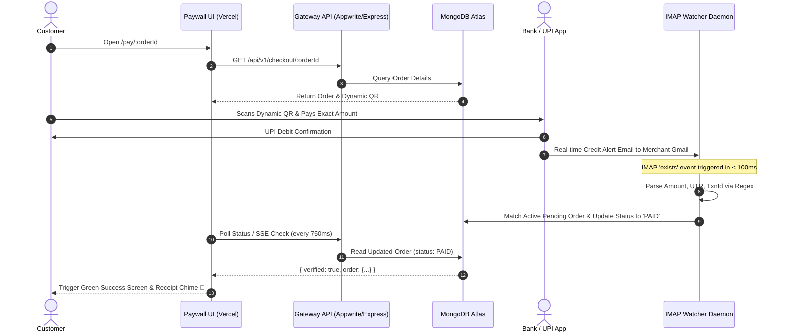

<div align="center">

# ⚡ SidPay • Automated UPI Payment Gateway

**by SidTech 366**

[](https://render.com/deploy?repo=https://github.com/sidtech366/Sidpay)

**A production-ready, open-source, 0%-fee automated UPI payment gateway with dynamic QR generation, micro-paise anti-collision allocation, and sub-second bank alert auto-verification.**

[](https://opensource.org/licenses/MIT)
[](https://nodejs.org/)
[](https://expressjs.com/)
[](https://www.mongodb.com/atlas)
[](https://appwrite.io/)
[](https://vercel.com/)

[Website](https://sidtech366.vercel.app) • [Architecture](#-architecture--lifecycle) • [Quick Start](#-quick-start) • [API Reference](#-api-reference) • [Deployment](#-cloud-deployment)

---

</div>

## 📖 Overview

Most payment aggregators charge **2% to 3% transaction fees** and require formal corporate merchant onboarding with extensive verification delays. 

**SidPay** is a high-performance, self-hosted, peer-to-peer (P2P) automated UPI gateway. It allows businesses, developers, and creators to accept direct UPI payments into their personal or business UPI handles (FamApp, PhonePe, Paytm, Google Pay, BHIM) with:

* **0% Transaction Fees**: 100% of customer funds settle instantly into your own UPI account.
* **Instant Auto-Verification**: Uses a persistent IMAP socket with Gmail push notification triggers to parse incoming bank credit alerts within **~100ms**.
* **Micro-Paise Concurrency Engine**: Solves multi-user payment collisions mathematically by allocating unique micro-offsets (e.g. ₹1.00, ₹1.01, ₹1.02) during simultaneous checkouts.
* **Modern Focused Paywall**: Clean, responsive checkout screen featuring animated dynamic QR codes, 1-click UPI ID copy, and live pulsating status radar.

---

## 🏗️ Architecture & Lifecycle

The sequence below illustrates the real-time payment verification flow:



---

## ✨ Key Features

### 1. 🛡️ Mathematical Anti-Collision Engine
When multiple users initiate checkouts for identical amounts at the same moment, traditional UPI P2P gateways cannot distinguish which user paid. SidPay solves this through dynamic **Micro-Paise Concurrency Slots**:
* **User 1**: Allocated ₹1.00 (`tr=PAY111`)
* **User 2**: Allocated ₹1.01 (`tr=PAY222`)
* **User 3**: Allocated ₹1.02 (`tr=PAY333`)
When User 1 pays ₹1.00, only User 1 receives verification. User 2's screen remains strictly in `PENDING` status until User 2's distinct payment of ₹1.01 arrives.

### 2. ⚡ Lightning-Fast Auto-Verification (< 1s)
* **UID Memoization**: Skips re-parsing older messages; only downloads the single newly arrived message stream.
* **IMAP IDLE Push**: Reacts immediately to TCP socket `exists` notifications emitted by Gmail.
* **Active Visibility Listener**: Browser automatically triggers an immediate zero-delay verification query the instant a user switches back from their UPI app.

### 3. 📱 Minimalist Dynamic Paywall & 1-Tap Mobile Intent
* **Dynamic QR Code**: Rendered via vector canvas with high error correction (`H`) and exact micro-paise amounts pre-filled.
* **1-Tap Mobile Intent Deep-Linking**:
  * **Direct UPI Intent & FamPay**: Standard universal system app selector (`upi://pay?...`).
  * **Google Pay**: Uses registered Tez scheme (`tez://upi/pay?...`).
  * **PhonePe**: Targeted deep-link (`phonepe://pay?...`).
  * **Paytm**: Package-targeted Android Intent (`intent://pay?...#Intent;scheme=upi;package=net.one97.paytm;end`) with `paytmmp://` iOS fallback.
  * **Navi & super.money**: Explicit Android package deep-links.
* **Strict NPCI Compliance**: Keeps the `@` symbol unencoded in the VPA (`pa=handle@fam` instead of `%40`) and appends `mode=00` to prevent bank app rejection.
* **Zero-Delay Status Radar**: Instant auto-polling (< 750ms) + visibility listener when switching back from UPI apps.

---

## 📁 Repository Structure

```
├── .env.example                # Environment variables template
├── appwrite.json               # Appwrite Cloud Functions configuration
├── package.json                # Project dependencies and npm scripts
├── server.js                   # Express master server & local runtime
├── vercel.json                 # Vercel deployment & API rewrites configuration
├── data/                       # Local data directory
├── functions/
│   └── payment-gateway/        # Serverless Appwrite Cloud Function
│       ├── package.json
│       └── src/
│           └── main.js         # Stateless cloud gateway controller
├── public/                     # Frontend client assets
│   ├── app.js                  # Merchant onboarding & dashboard logic
│   ├── index.html              # Landing page & merchant dashboard
│   ├── js/
│   │   └── checkout.js         # Mobile UPI deep-linking & intent builder
│   ├── paywall.css             # Paywall styling & laser scanner animation
│   ├── paywall.html            # Hosted customer checkout screen with 1-tap intent
│   ├── paywall.js              # Real-time polling & success handler
│   └── style.css               # Global application stylesheet
├── services/
│   ├── concurrencyWatcher.js   # IMAP daemon & real-time matching engine
│   ├── emailMonitor.js         # Fallback periodic email reader
│   ├── mongo.js                # Mongoose connection & schemas
│   ├── paymentParser.js        # Bank alert regex extractor (UTR, Amount)
│   ├── qrHelper.js             # Dynamic NPCI UPI URI & QR generator
│   └── store.js                # Dual local & MongoDB persistence layer
├── src/
│   └── utils/
│       └── qr.util.js          # Core NPCI URI builder & QR generator
└── uploads/                    # Merchant QR codes & media uploads
```

---

## 🚀 Quick Start

### Prerequisites
* **Node.js**: v18.0.0 or higher
* **MongoDB**: A free MongoDB Atlas cluster or local MongoDB instance
* **Gmail Account**: With an [App Password](https://myaccount.google.com/apppasswords) enabled (requires 2-Step Verification)

### 1. Clone the Repository
```bash
git clone https://github.com/sidtech366/Sidpay.git
cd automated-payment-gateway
```

### 2. Install Dependencies
```bash
npm install
```

### 3. Configure Environment Variables
Copy `.env.example` to `.env`:
```bash
cp .env.example .env
```
Fill in your configuration:
```env
PORT=3000
PAYEE_NAME="Your Name"
UPI_ID="yourhandle@upi"
BUSINESS_NAME="SidTech 366"

GMAIL_USER="your-email@gmail.com"
GMAIL_APP_PASS="your-16-char-app-password"

MONGODB_URI="mongodb+srv://<username>:<password>@cluster.mongodb.net/sidpay?retryWrites=true&w=majority"
```

### 4. Start the Server
```bash
# Start production server
npm start

# Or start in watch mode for development
npm run dev
```

Visit `http://localhost:3000` to access the Merchant Portal, or open `http://localhost:3000/pay/new` to create a live test payment.

---

## 🌐 Cloud Deployment

SidPay is architected for hybrid or split deployment:

### 1. Frontend on Vercel
Deploy the `public/` directory directly to Vercel:
```bash
npx vercel deploy public --prod
```
The included `vercel.json` automatically configures clean URLs and proxies `/api/*` routes to your backend service.

### 2. Serverless API on Appwrite Functions
The `functions/payment-gateway` directory contains the complete serverless function for Appwrite Cloud:
```bash
npx -p appwrite-cli appwrite push functions --all --force
```

### 3. Background Daemon (IMAP Socket)
Run `node server.js` on any persistent Node.js environment (Railway, Render, VPS, or Docker) to maintain the live IMAP connection with Gmail.

---

## 📡 API Reference

### 1. Create Dynamic Order
Generates a unique dynamic order with anti-collision amount and dynamic QR code.

* **Endpoint**: `POST /api/v1/checkout/create`
* **Headers**: `Content-Type: application/json`

**Request Body:**
```json
{
  "amount": 10.00,
  "customerName": "John Doe",
  "customerEmail": "john@example.com",
  "note": "Pro Subscription"
}
```

**Response (201 Created):**
```json
{
  "success": true,
  "orderId": "PAY-898968-338",
  "amount": 10.00,
  "currency": "INR",
  "status": "PENDING",
  "paywallUrl": "/pay/PAY-898968-338",
  "dynamicUpiUrl": "upi://pay?pa=yourhandle@fam&pn=Apex%20Cloud&am=10.00&cu=INR&tn=PAY898968338&tr=PAY898968338",
  "dynamicQrDataUrl": "data:image/png;base64,iVBORw..."
}
```

---

### 2. Check Order Status
Real-time endpoint called by the checkout paywall to detect verified payments.

* **Endpoint**: `GET /api/v1/checkout/status/:orderId`

**Response (200 OK):**
```json
{
  "success": true,
  "verified": true,
  "order": {
    "orderId": "PAY-898968-338",
    "amount": 10.00,
    "status": "PAID",
    "verifiedAt": "2026-11-16T14:20:24.260Z",
    "paymentDetails": {
      "amount": 10.00,
      "utr": "668612930011",
      "txnId": "FMPIB7007283579",
      "senderName": "UPI Customer"
    }
  }
}
```

---

### 3. Manual UTR Verification
Allows customers to verify their transaction manually by providing their 12-digit bank reference number.

* **Endpoint**: `POST /api/v1/checkout/verify-utr`
* **Headers**: `Content-Type: application/json`

**Request Body:**
```json
{
  "orderId": "PAY-898968-338",
  "utr": "668612930011"
}
```

**Response (200 OK):**
```json
{
  "success": true,
  "verified": true,
  "order": {
    "orderId": "PAY-898968-338",
    "status": "PAID"
  }
}
```

---

## 🔒 Security Best Practices

1. **Never commit `.env` or credentials**: Ensure `.env` and `data/store.json` remain in your `.gitignore`.
2. **App Passwords**: Never use your primary Google account password; always use a dedicated Gmail 16-character App Password.
3. **Database Rules**: Ensure your MongoDB Atlas cluster IP access list is restricted to your production servers or uses secure VPC peering.

---

## 🤝 Contributing

Contributions are welcomed! Follow these steps:
1. Fork the Project
2. Create your Feature Branch (`git checkout -b feature/AmazingFeature`)
3. Commit your Changes (`git commit -m 'Add some AmazingFeature'`)
4. Push to the Branch (`git push origin feature/AmazingFeature`)
5. Open a Pull Request

---

## 📱 SMS Verification (Bank of Baroda / Jio Payments Bank)

For banks that do not send credit alert emails, SidPay verifies payments from the bank's **credit SMS**.

1. On the Android phone that has the bank SIM, install **SMS to URL Forwarder** (F-Droid, open-source).
2. Add a rule: Sender `*`, URL `https://YOUR_SERVER/api/v1/sms-webhook?secret=YOUR_SMS_WEBHOOK_SECRET`
3. Set in `.env`:

```env
SMS_WEBHOOK_SECRET="long-random-secret-min-16-chars"
SMS_ALLOWED_SENDERS="BOBSMS"      # JK-BOBSMS-S / JX-BOBSMS-S -> BOBSMS
SMS_ACCOUNT_LAST4="3050"          # optional, last digits shown in SMS
```

Only credit SMS from trusted bank headers are accepted. Debit SMS (`Dr. from A/C ...`), reversals and refunds are ignored. The phone must stay on and connected to the internet. Gmail settings are optional in SMS mode.

---

## 🔒 SidPay Security Settings (required)

Add these to your `.env`:

```env
# Bank alert senders to trust (email or domain, comma separated)
ALLOWED_SENDERS="alerts@hdfcbank.net,sbi.co.in"
# Dashboard login password for the default merchant
MERCHANT_PASSWORD="choose-a-strong-password"
# Keep false in production (test-only fake payment endpoint)
ENABLE_SIMULATION=false
```

Payment emails are accepted **only** when the sender is in `ALLOWED_SENDERS` **and** Gmail's DMARC/DKIM check passed. If `ALLOWED_SENDERS` is empty, no payment is auto-verified.

---

## 📄 License

Distributed under the **MIT License**. See [`LICENSE`](LICENSE) for more information.

---

<div align="center">
  <sub><b>SidTech 366</b> • CEO Akshay Anand • 📞 7069492135 • ✉️ sidtech366@gmail.com • 🌐 <a href="https://sidtech366.vercel.app">sidtech366.vercel.app</a></sub><br>
  <sub>Based on the open-source <a href="https://github.com/monu564100/automated-payment-gateway">automated-payment-gateway</a> by Monu Kumar (MIT License)</sub>
</div>
